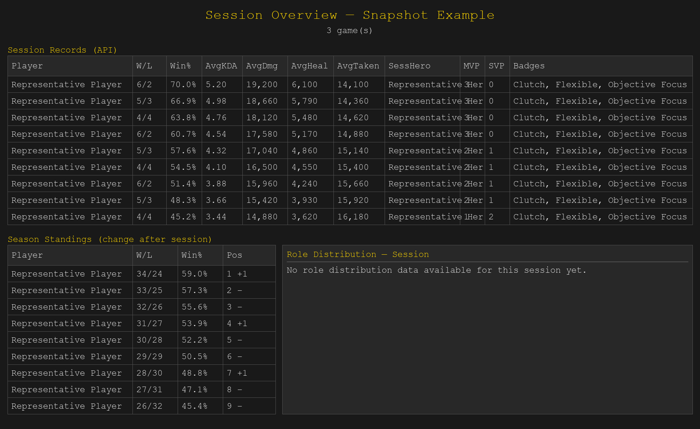
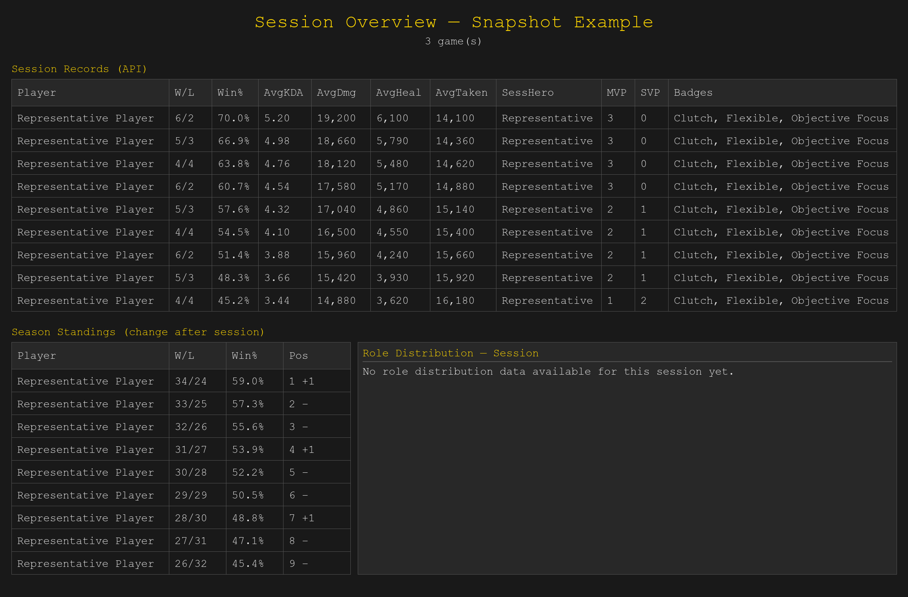
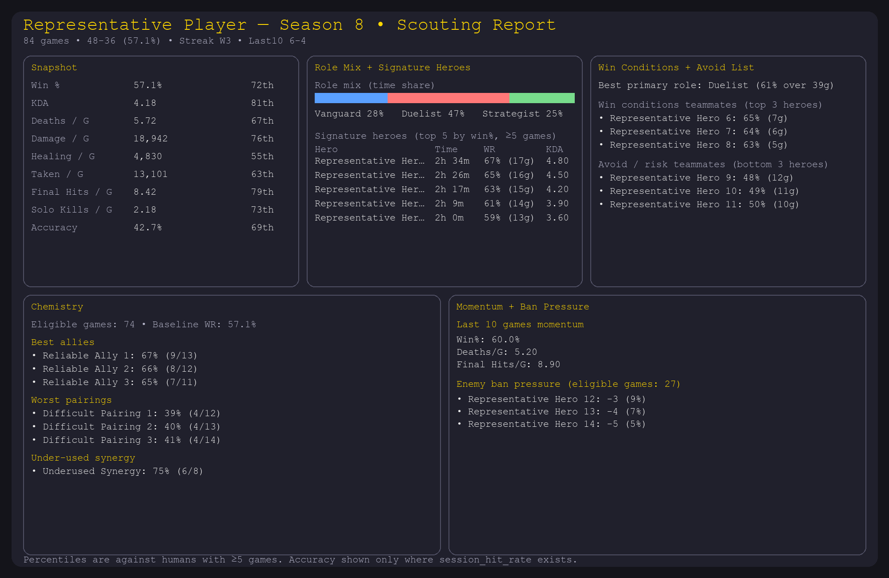
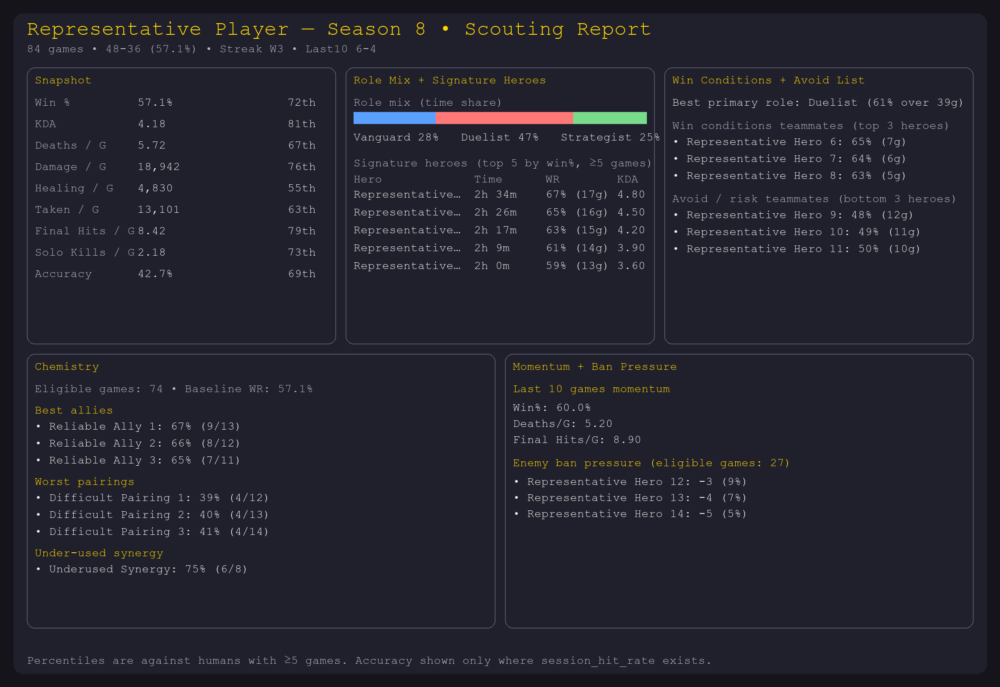

# Image Readability Evidence

These images are offline layout regressions generated with representative data
through the real Jarvis renderers. The process points `MR_DB_PATH` at a temporary
copy of the bundled historical snapshot. The images do not represent current
live statistics.

## Session Overview

Before (`1860x1142`):

After (`2226x1466`):

## Profile Dashboard

Before (`2000x1300`):

After (`2240x1540`):

